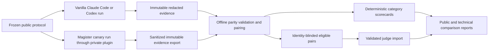

# Agent-system comparison and capability scorecards: technical design

## Context

The implementation is based on standalone commit `11525df` and the private
Magister eval branch at `ad8c5959e1`.

- [`engine.py` at `11525df`](https://github.com/Magister-Marketing/marketing-benchmark/blob/11525df/evals/runner/engine.py#L470-L563)
  constructs one adapter for a run, which is appropriate for separately
  executable baseline and treatment evidence but cannot compare runtimes inside
  a single run.
- [`report.py` at `11525df`](https://github.com/Magister-Marketing/marketing-benchmark/blob/11525df/evals/runner/report.py#L76-L167)
  aggregates candidate, task family, and environment mode. It has Wilson
  intervals and reliability/efficiency data but no evaluation-type scorecard or
  cross-run pairing.
- [`judging.py` at `11525df`](https://github.com/Magister-Marketing/marketing-benchmark/blob/11525df/evals/runner/judging.py#L58-L121)
  creates good identity-blinded pairs, but only from candidates in one run.
- [`claude_code.py` at `11525df`](https://github.com/Magister-Marketing/marketing-benchmark/blob/11525df/evals/runner/adapters/claude_code.py)
  is the portable Claude Code reference adapter. The current branch additionally
  handles deferred tool discovery, exact fixture manifests, and a file-backed
  portable UI bridge discovered during dogfooding.
- [`experiment.v2.schema.json` at `11525df`](https://github.com/Magister-Marketing/marketing-benchmark/blob/11525df/evals/schema/experiment.v2.schema.json#L20-L24)
  already distinguishes `model` from `agent_system`, but the latter is currently
  descriptive metadata only.
- [`MAGISTER_INTEGRATION.md` at `11525df`](https://github.com/Magister-Marketing/marketing-benchmark/blob/11525df/docs/MAGISTER_INTEGRATION.md)
  defines the intended open-core/private-plugin boundary. The Magister branch
  still duplicates the portable runner and must migrate to the package/plugin
  boundary before public release.

The design keeps paid execution separate per adapter. This avoids mixing
confirmation tokens, credentials, and live/private environments in one process,
and allows a public baseline and private treatment to be produced on different
machines. A new offline comparison layer joins sanitized completed runs.

## Proposed changes

### 1. Scenario classification and category grades

- Add `evaluation_types` to scenario v2 with values `general_chat`,
  `skill_use`, `ui_rendering`, and `integration`. Store it on `Scenario` and in
  each grade row.
- Backfill every bundled v2 scenario explicitly. Do not infer categories from
  names or tags in new manifests. A compatibility inference may be used only
  when reading existing v1 scenarios and must be visible in evidence.
- Add a category-result object to each deterministic grade:
  `applicable`, `passed`, contributing gate ids, and a reason. Category pass is
  derived from deterministic gates/objective checks as specified in PRODUCT
  invariants 10–13.
- Add at least one self-contained, no-skill/no-UI/no-integration general-chat
  scenario and rubric. Its objective constraints make repeat runs useful before
  subjective judging is imported.

### 2. Planned-denominator and scorecard aggregation

- Build an expected-attempt index from the resolved run manifest, then left-join
  attempts and grades. This makes missing, infrastructure, and contaminated
  cells part of execution and end-to-end denominators.
- Add `build_scorecards()` beside the existing aggregate/capability builders.
  It computes per-system and per-category scenario rates, macro-averages,
  Wilson intervals for raw binary cells, pass counts, planned counts, and thin-
  evidence warnings.
- Keep the current conditional quality aggregates for model analysis, but label
  them as conditional. Route selection continues to be lexicographic.
- Add the scorecard to `report.json`, `public-report.json`, the technical
  Markdown report, and the scan-friendly public table. Include `skill_use` in
  the Markdown capability matrix instead of dropping that machine axis.

### 3. Offline paired comparisons

- Add an offline `compare` command accepting baseline and treatment run paths,
  stable system labels, and a treatment declaration file. It writes immutable
  comparison artifacts under `artifacts/comparisons/<comparison-id>/`.
- Validate both run manifests and evidence before joining. Pair keys are model,
  normalized requested settings, scenario id/version/hashes, repetition, random
  seed, environment mode/fixture/clock, and judge rubric. Store matched,
  mismatched, missing-baseline, and missing-treatment rows separately.
- Compute paired percentage-point deltas for binary scores. Use seeded paired
  bootstrap intervals for reliability, latency, cost, and continuous rubric
  values. Record the method, seed, and sample count in JSON.
- Do not pool live and replay evidence. A comparison containing both produces
  separate blocks.
- Generate a public comparison report with baseline, treatment, absolute scores,
  deltas, intervals, counts, cost-method warnings, and limitations. Do not emit
  an opaque weighted score.

### 4. Cross-run blind judging

- Add `compare-judge-plan` that selects only matched pairs where both attempts
  satisfy end-to-end eligibility. Reuse the existing redaction, random A/B
  ordering, rubric packet, and separate identity map.
- Add `compare-judge-import` with the existing schema validation and stable
  judge id. Join overall and per-dimension W/T/L after import.
- Record a deterministic reliability outcome separately when only one side of a
  matched pair is eligible. Never submit invalid output to the creative judge.

### 5. Vanilla runtime adapters

- Keep Claude Code as a reference adapter. Pin the adapter evidence to CLI
  version, translate deferred `ToolSearch` as control-plane evidence, stage an
  exact fixture manifest, and accept `deliverables/ui.json` as the portable UI
  bridge.
- Add a Codex CLI reference adapter around `codex exec --json --ephemeral`.
  Invoke it with an explicit model, reasoning effort, verbosity, disabled web
  search, workspace-write sandbox, no interactive approvals, ignored user
  config/rules, and an attempt-owned workspace. Normalize thread/turn, agent
  message, reasoning, command/file change, and MCP tool events into the shared
  vocabulary.
- Fail Codex commands closed when their effect cannot be classified. Detect
  required skill reads from successful reads of staged `SKILL.md` paths, collect
  run-owned artifacts, translate `deliverables/ui.json`, and attach only the
  attempt-owned replay MCP.
- Codex CLI does not currently expose every provider request knob, including a
  documented output-token setting. Extend setting manifests so an agent-system
  comparison can explicitly request `provider_default` for unsupported knobs;
  require the Magister pair to use the same request mode. Never silently claim
  that an unavailable setting was applied.

### 6. Magister downstream integration

- Publish/install the portable package privately first. Replace Magister's
  duplicated portable modules with the package and register the private canary
  adapter and Team+Test environment through entry points.
- Keep Team+Test identities, Supabase/service-role access, production endpoints,
  model override tables, live GA4 property allowlists, and renderer catalog
  validation in the Magister repository.
- Add private agent-system candidates that differ only by adapter/system label
  from the vanilla candidates. Run each side separately with the same frozen
  experiment, export sanitized treatment evidence, then execute offline compare
  in the standalone repository.
- Gate treatment runs on PR #890 deployment, migration availability, dark flag,
  exact project UUID allowlist, canary lease, and operator cost confirmation.

### 7. Public protocol and treatment declaration

- Add a schema for the treatment declaration: system id/label, adapter/runtime
  version, prompt layer hash, skill bundle hash, UI bridge/catalog hash, tool
  environment hash, and a prose list of intended differences.
- Document two claims separately: model-profile comparisons (same agent system,
  different model/settings) and agent-system comparisons (same model/settings,
  different harness). Reports reject mixed claims.
- Export checks continue to prove that the public package contains no Magister
  private paths or content.

## End-to-end flow

## Testing and validation

- Schema tests cover accepted categories, rejected unknown values, treatment
  declarations, explicit setting modes, and backward-compatible v1 loading.
- Unit tests cover planned-attempt left joins, missing/infra/contaminated
  denominators, scenario macro-averaging, category gate selection, live/replay
  separation, and thin-sample warnings (PRODUCT 7–15, 19–21).
- Comparison tests use synthetic paired runs to verify every parity field,
  mismatch reporting, deterministic pair keys, delta direction, seeded
  intervals, and cost-method warnings (PRODUCT 3–5, 18, 20).
- Judge tests verify identity hiding, eligibility, reliability wins, per-
  dimension W/T/L, duplicate judge protection, and no invalid output in packets
  (PRODUCT 16–17).
- Adapter contract tests use representative, redacted Claude Code and Codex
  JSONL events. Paid smoke tests remain opt-in and never run in CI (PRODUCT 2,
  6).
- Run three repetitions each for one general-chat scenario, the skill/UI ads
  scenario, and GA4 replay. A valid smoke requires no adapter-caused failures and
  produces all four category rows (PRODUCT 7–14).
- After PR #890 is deployed only to Team+Test, run the same three-cell protocol
  through Magister and generate the first paired comparison. Do not change a
  production default until the comparison spans multiple scenarios per category
  and the intervals are decision-useful (PRODUCT 18, 23, 26).
- `make check` remains provider-free. Export-boundary tests verify that private
  Magister code and identities never enter the standalone package (PRODUCT 25).

## Parallelization

Implementation sub-agents are not proposed for the first slice because schema,
grading, reporting, comparison statistics, and fixtures share the same compact
Python surface and must evolve in lockstep. Paid eval cells can run serially in
the background while local implementation and offline tests proceed. A later
Codex adapter can be isolated in its own worktree once the setting and event
contracts in this spec land.

## Risks and mitigations

- **Apples-to-oranges claims:** fail parity validation closed and print every
  mismatch; require an intended-treatment declaration.
- **Harness failures blamed on models:** count them in execution/end-to-end
  system scores, retain raw adapter evidence, and keep conditional model quality
  separate.
- **Judge bias or leakage:** reuse blinded packets, pin judge configuration, and
  show sample/agreement data.
- **Overconfident small samples:** show counts and intervals, label thin cells,
  and avoid universal routing claims.
- **Different cost accounting:** record method and warn instead of claiming
  exact savings.
- **Private-data leakage:** compare only sanitized exports and keep the existing
  clean-room boundary check mandatory.
- **External side effects:** use synthetic replay by default; keep live
  acceptance read-only, canary-pinned, separately confirmed, and separately
  reported.
